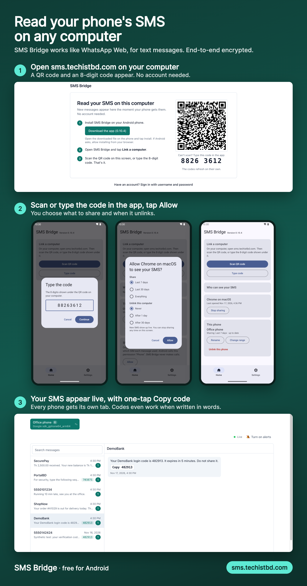
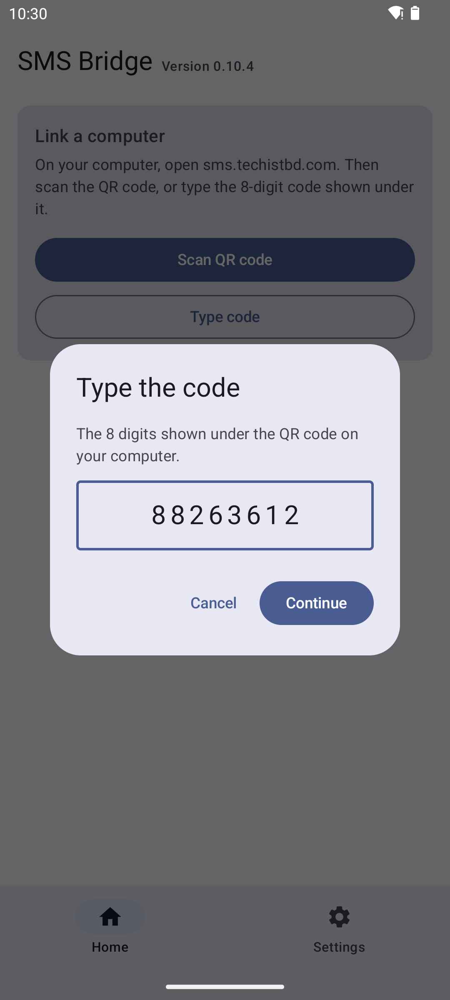
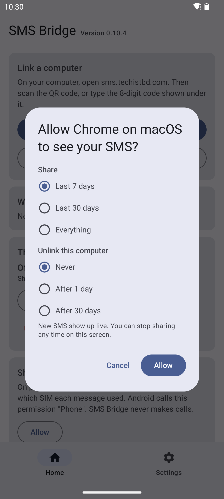
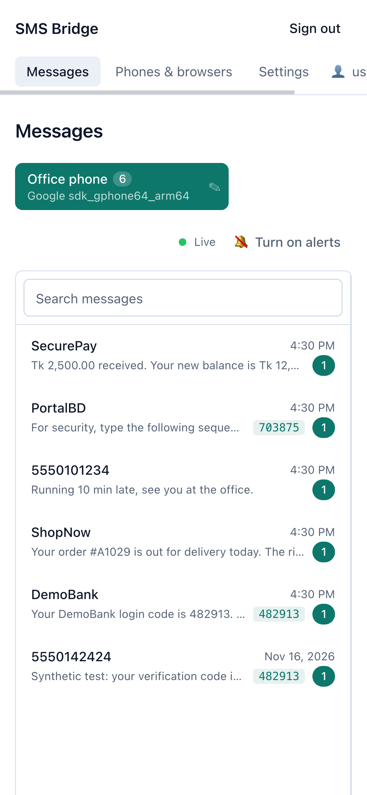

# SMS Bridge

**Read your Android phone's SMS on any computer, end-to-end encrypted.** It works like
WhatsApp Web, but for text messages: open the website, scan a QR code (or type an 8-digit code)
with the app, and new SMS appear in the browser the moment the phone receives them.

Live at **[sms.techistbd.com](https://sms.techistbd.com)** · Android app + self-hosted server + web app



## Features

- **One-scan linking:** scan the QR code or type the 8-digit code. No account is needed to start;
  a username and password can be saved later to sign in from any browser.
- **Consent first:** the phone asks before a computer can read anything, what to share (last 7 days,
  30 days or everything), and when to unlink it automatically. Stop sharing at any time.
- **Live messages:** new SMS arrive within seconds over a WebSocket, with desktop alerts.
- **Several phones in one place:** a tab per phone with your own names ("Office phone"),
  SIM 1 / SIM 2 labels and carrier names on dual-SIM phones.
- **One-tap codes:** a Copy button on OTP messages, including codes spelled out in words
  ("Seven_Zero_Three…" → 703875).
- **Move a phone between accounts:** sign in to an existing account after scanning and the phone
  moves there on its own.
- **Remove phones and browsers:** removing a phone also deletes its messages from the server.
- **On the phone:** a private local archive, encrypted backup and restore, and phone-to-phone
  transfer over Wi-Fi.
- **In-app updates** for the directly distributed APK.

| Typed code | Consent | Messages in the browser |
|---|---|---|
|  |  |  |

## Security design

The server stores only data it cannot read.

- **End-to-end encryption:** messages are encrypted on the phone with an account vault key
  (AES-256-GCM). The vault key is wrapped for each approved device with HPKE
  (X25519, HKDF-SHA256, AES-256-GCM). Every upload is signed (Ed25519) by the phone.
- **Browser keys** are non-extractable WebCrypto keys kept in IndexedDB.
- **Linking is verified:** the QR code carries a fingerprint of the browser's keys, and the phone
  refuses keys that do not match. Adding a phone uses a one-time pairing code plus an HMAC proof.
- **Passwords never leave the browser:** the server receives a PBKDF2-derived login secret; a
  separately salted key derived from the password opens the vault, so the password alone can sign
  in from a new browser without the server ever being able to.
- **No message content in logs**, rate-limited sign-in, CSRF protection, optional TOTP two-factor,
  encrypted database backups.

Details: [docs/security.md](docs/security.md) and [docs/sync-design.md](docs/sync-design.md).

## Architecture

```
 Android phone                         Server (VPS, Docker)                 Browser
┌────────────────────┐   encrypted   ┌───────────────────────┐  encrypted ┌──────────────────┐
│ SMS reader → Room  │ ────────────► │ Ktor API + PostgreSQL │ ─────────► │ Next.js web app  │
│ encrypt + sign     │   events      │ stores ciphertext,    │  events +  │ decrypts in the  │
│ approve browsers   │ ◄──────────── │ wakes devices         │  live WS   │ tab (WebCrypto)  │
└────────────────────┘  wake-ups     └───────────────────────┘            └──────────────────┘
```

| Part | Stack |
|---|---|
| `android/` | Kotlin, Jetpack Compose, Hilt, Room, WorkManager, Tink, ZXing |
| `backend/` | Kotlin, Ktor, PostgreSQL, Flyway, HikariCP |
| `web/` | Next.js (static export), TypeScript, Tailwind CSS, WebCrypto |
| `infrastructure/` | Docker Compose, Caddy (HTTPS), encrypted backups |

About 22,000 lines of Kotlin and TypeScript, with tests on every layer: Android unit tests,
backend integration tests against a real PostgreSQL (Testcontainers), and web tests, plus shared
crypto test vectors that the phone produces and the browser checks.

## Repository layout

```
sms-bridge/
├── android/          Android app
├── backend/          Server API
├── web/              Web app
├── infrastructure/   Docker Compose, Caddy, backup script
├── docs/             Architecture, security, sync design, development, deployment
├── testdata/         Cross-language crypto vectors
└── tools/            Release and synthetic test-data scripts
```

## Running it locally

```bash
# Android app
cd android && ./gradlew assembleDebug testDebugUnitTest

# Server tests (needs Docker for PostgreSQL)
cd backend && ./gradlew test

# Web app
cd web && npm install && npm test && npm run build
```

Full setup: [docs/development.md](docs/development.md) · Deployment: [docs/deployment.md](docs/deployment.md)

## Licence

Copyright © 2026 Amrita Chandra Das. All rights reserved. The source is shown here as a portfolio
project; it may not be copied, modified or redistributed without permission. See [LICENSE](LICENSE).
